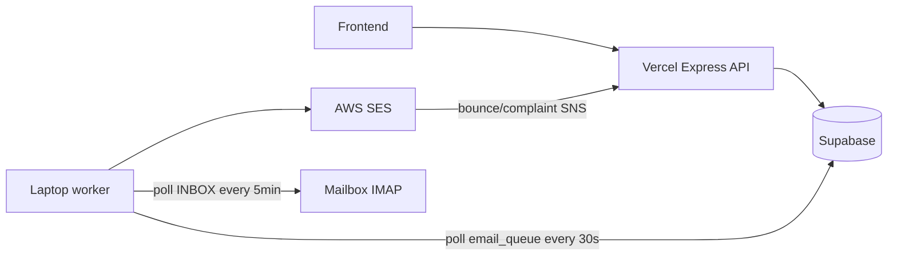

# B2B Organizer — API

Backend API and worker for the B2B email outreach platform. Built with Node.js, Express, and Supabase.

---

## Architecture

The backend runs as **two separate processes**:

| Process | Command | Where it runs | Role |
|---|---|---|---|
| API Server | `npm run dev:api` / Vercel | **Vercel** (serverless) or local | HTTP API, SES bounce webhook |
| Worker | `npm run worker` / `npm run dev:worker` | **Always-on laptop** (or any long-lived host) | Sends emails via SES + catches replies via IMAP |



**Do not run more than one worker instance** — concurrent pollers can double-claim or race on the same jobs.

---

## Tech Stack

- **Runtime:** Node.js + TypeScript
- **Framework:** Express (wrapped for Vercel serverless)
- **Queue:** Supabase `email_queue` table (DB-backed poller)
- **Database & Auth:** Supabase (PostgreSQL + Auth)
- **Email Sending:** AWS SES
- **Reply Catching:** IMAP (imapflow) on the worker process
- **Validation:** Zod
- **API Docs:** Swagger UI (`/api/docs`)

---

## Getting Started

### 1. Install dependencies

```bash
npm install
```

### 2. Configure environment

```bash
cp .env.example .env
```

Fill in the required values (see [Environment Variables](#environment-variables) below).

### 3. Run database migrations

Run these in order in the Supabase SQL editor:

```
supabase/migrations/001_initial_schema.sql
supabase/migrations/002_campaign_mailboxes.sql
supabase/migrations/003_leads_unique.sql
supabase/migrations/004_mailbox_warmup.sql
supabase/migrations/005_email_verifications.sql
supabase/migrations/006_org_management.sql
supabase/migrations/007_simplify_org.sql
supabase/migrations/008_campaigns_direct_leads.sql
supabase/migrations/009_leads_campaign_direct.sql
supabase/migrations/010_email_tracking.sql
supabase/migrations/011_global_admin.sql
supabase/migrations/012_set_global_admins.sql
supabase/migrations/013_unsubscribe_tokens.sql
```

### 4. Start development

Run API + worker together:

```bash
npm run dev
```

Or separately:

```bash
npm run dev:api      # http://localhost:3000 — API only
npm run dev:worker   # email sender + IMAP reply catcher
```

Swagger docs: `http://localhost:3000/api/docs`

---

## Environment Variables

| Variable | API / Vercel | Worker | Description |
|---|---|---|---|
| `SUPABASE_URL` | Required | Required | Project URL from Supabase → Settings → Data API |
| `SUPABASE_SERVICE_ROLE_KEY` | Required | Required | Service role key (bypasses RLS — keep secret) |
| `FRONTEND_URL` | Required | Required | Frontend base URL (invites, verification, unsubscribe links) |
| `API_URL` | Required | Required | Public API base URL (`List-Unsubscribe` headers). On Vercel: `https://your-project.vercel.app` |
| `AWS_ACCESS_KEY_ID` | Required | Required | IAM key with SES access |
| `AWS_SECRET_ACCESS_KEY` | Required | Required | IAM secret |
| `AWS_REGION` | Required | Required | SES region, e.g. `eu-west-1` |
| `SES_FROM_EMAIL` | Required | — | Verified SES identity for **system** mail (invites, etc.). Campaigns use `mailbox.email` |
| `SES_WEBHOOK_SECRET` | Required | — | Protects `POST /webhooks/ses` |
| `IMAP_ENCRYPTION_KEY` | Required | Required | 64 hex chars — encrypt IMAP passwords on create / decrypt on worker |
| `PORT` | Optional | — | Local API only (default `3000`). Not used on Vercel |

Generate the encryption key:
```bash
node -e "console.log(require('crypto').randomBytes(32).toString('hex'))"
```

Generate the webhook secret:
```bash
node -e "console.log(require('crypto').randomBytes(24).toString('hex'))"
```

---

## Deploy API on Vercel (Hobby)

1. Push this repo and import the project in Vercel.
2. Set the **API / Vercel** env vars from the table above (including `SES_FROM_EMAIL` and `SES_WEBHOOK_SECRET`).
3. Deploy. Confirm:
   - `GET https://your-project.vercel.app/health` → `{ "status": "ok" }`
   - `GET https://your-project.vercel.app/api/docs` → Swagger UI
4. Set `API_URL` to your Vercel URL (and `FRONTEND_URL` to the frontend).
5. Point AWS SNS bounce/complaint subscription to:
   `https://your-project.vercel.app/webhooks/ses?token=YOUR_SES_WEBHOOK_SECRET`

**Lead import size:** Vercel Hobby request bodies are limited to ~4.5 MB. Excel uploads are capped at **4 MB** in multer.

The Vercel function must **not** run workers — only `api/index.ts` exports the Express app.

---

## Laptop worker (email sender + IMAP)

Campaign sending and reply catching need a long-lived Node process. Run it on an always-on laptop (or any always-on machine).

### Setup

```bash
git clone <this-repo>
cd ai-first-biz-dev-b2b-organizer-api
npm install
cp .env.example .env   # same Supabase / AWS / IMAP / URL values as production
npm run build
npm run worker
```

The worker only needs **outbound** network access (Supabase, SES, IMAP). No public URL or tunnel.

### Keep it running (Mac)

1. **Prevent sleep while plugged in**
   - System Settings → **Lock Screen** (or **Energy** / **Battery** on older macOS) → set **Turn display off on power adapter when inactive** to **Never** (or a long interval).
   - Optional (keeps the Mac awake even with the lid closed on many models when on AC + external display, or use `caffeinate`):
     ```bash
     # Keep the system awake while the worker runs (run in a separate terminal, or wrap pm2)
     caffeinate -dimsu &
     ```
2. **Auto-start on login** with **pm2**:
   ```bash
   npm install -g pm2
   cd /path/to/ai-first-biz-dev-b2b-organizer-api
   npm run build
   pm2 start dist/worker.js --name b2b-worker
   pm2 save
   pm2 startup   # prints a sudo command — run it so pm2 restores on reboot
   ```
   Useful commands: `pm2 status`, `pm2 logs b2b-worker`, `pm2 restart b2b-worker`.
3. Run **exactly one** worker instance. Stopping Railway/old API workers first avoids double-sends.

### Smoke test

1. Create a campaign in the UI (API on Vercel).
2. Confirm a row appears in Supabase `email_queue`.
3. Laptop worker logs a send via SES.
4. Reply to the campaign email from the lead address.
5. Within ~5 minutes, worker IMAP poll marks the lead `replied`.

---

## Cutover checklist (Railway → Vercel + laptop)

1. Deploy API to Vercel; set env vars; confirm `/health` and `/api/docs`.
2. Update SNS bounce webhook URL to the Vercel `/webhooks/ses?token=...` endpoint.
3. Set production `API_URL` / `FRONTEND_URL`.
4. Start `npm run worker` on the always-on laptop (process manager + no sleep).
5. Smoke-test send + IMAP reply (above).
6. Stop the old Railway (or Docker) API process so it no longer runs embedded workers — or keep Railway only as a cold backup with workers disabled.

---

## API Endpoints

Full interactive docs at `/api/docs`. Summary:

### Auth
| Method | Path | Description |
|---|---|---|
| `POST` | `/api/auth/register` | Create a new company + admin user |
| `POST` | `/api/auth/login` | Sign in, returns `access_token` and `refresh_token` |
| `POST` | `/api/auth/refresh` | Exchange a `refresh_token` for a new `access_token` |

### Company
| Method | Path | Description |
|---|---|---|
| `GET` | `/api/company` | Get company profile |
| `PATCH` | `/api/company` | Update company profile |
| `GET` | `/api/company/users` | List team members |

### Organization Management
| Method | Path | Description |
|---|---|---|
| `GET` | `/api/org/invitations` | List pending invitations |
| `POST` | `/api/org/invitations` | Send an invitation email |
| `DELETE` | `/api/org/invitations/:id` | Revoke a pending invitation |
| `GET` | `/api/org/invitations/check?token=` | Check invitation validity (public) |
| `POST` | `/api/org/accept-invite/register` | Accept invitation — create new account |
| `POST` | `/api/org/accept-invite/login` | Accept invitation — existing user joins second company |
| `DELETE` | `/api/org/members/:id` | Remove a team member from this company |

### Mailboxes
| Method | Path | Description |
|---|---|---|
| `GET` | `/api/mailboxes` | List mailboxes (IMAP config omitted) |
| `POST` | `/api/mailboxes` | Add a mailbox (IMAP config encrypted at rest) |
| `DELETE` | `/api/mailboxes/:id` | Remove a mailbox |

### Target Groups
| Method | Path | Description |
|---|---|---|
| `GET` | `/api/target-groups` | List target groups |
| `POST` | `/api/target-groups` | Create a target group |
| `DELETE` | `/api/target-groups/:id` | Delete a target group (fails if linked to a campaign) |

### Leads
| Method | Path | Description |
|---|---|---|
| `GET` | `/api/leads` | List leads (`?target_group_id=`, `?page=`, `?limit=`) |
| `PATCH` | `/api/leads/:id` | Update lead status or notes |
| `POST` | `/api/leads/preview` | Parse an Excel file and return its column headers |
| `POST` | `/api/leads/import` | Import leads from `.xlsx` file (max **4 MB** on Vercel) |

### Sequences
| Method | Path | Description |
|---|---|---|
| `GET` | `/api/sequences` | List all sequences with steps |
| `POST` | `/api/sequences` | Create a sequence |
| `GET` | `/api/sequences/:id` | Get a single sequence with steps |
| `DELETE` | `/api/sequences/:id` | Delete a sequence and all its steps |
| `POST` | `/api/sequences/:id/steps` | Add a step |
| `PATCH` | `/api/sequences/:id/steps/:stepId` | Edit a step |
| `DELETE` | `/api/sequences/:id/steps/:stepId` | Delete a step |

### Campaigns
| Method | Path | Description |
|---|---|---|
| `GET` | `/api/campaigns` | List campaigns |
| `POST` | `/api/campaigns` | Create campaign and start sending |
| `GET` | `/api/campaigns/:id` | Get a single campaign |
| `PATCH` | `/api/campaigns/:id` | Update status (`active`, `paused`, `completed`) or name |
| `GET` | `/api/campaigns/:id/stats` | Get stats (sent / pending / replied + breakdown) |

### Admin (global_admin role only)
| Method | Path | Description |
|---|---|---|
| `GET` | `/api/admin/mailboxes` | List all mailboxes with `ses_status = pending` across all companies |
| `PATCH` | `/api/admin/mailboxes/:id/approve` | Verify SES identity, mark mailbox active, activate waiting campaigns |

### Unsubscribe (public — no auth)
| Method | Path | Description |
|---|---|---|
| `POST` | `/api/unsubscribe` | Unsubscribe a lead by token (accepts token in JSON body or query string) |

### Webhooks
| Method | Path | Description |
|---|---|---|
| `POST` | `/webhooks/ses?token=SECRET` | Receives SES bounce and complaint notifications from SNS |

---

## How the Worker Works

### Email Sender
Polls the DB `email_queue` every 30 seconds. When `POST /api/campaigns` is called, jobs are created per lead with scheduled delays. For each job the worker:

1. Checks if the mailbox is paused — skips if true
2. Checks today's send count against the daily limit — requeues for tomorrow if exceeded
3. Checks if the lead is still `active` — skips if `replied`, `unsubscribed`, etc.
4. Merges `{{first_name}}`, `{{last_name}}`, `{{email}}`, `{{full_name}}` into the subject and body
5. Fetches the lead's unsubscribe token and appends an unsubscribe link to the email body
6. Adds `List-Unsubscribe` and `List-Unsubscribe-Post` headers (RFC 8058 one-click unsubscribe)
7. Sends the email via AWS SES
8. Writes a row to `email_logs` with status `sent`
9. If there is a next sequence step, schedules it at a random time within working hours on the target day

### Reply Catcher
Polls every 5 minutes (on the **worker** process only). For each mailbox:

1. Connects via IMAP and reads unseen emails from the last 24 hours
2. Matches the sender email against leads that were previously contacted
3. Categorizes the reply body using keyword matching (supports English and Bulgarian):
   - **Positive:** interest, yes, sure, schedule, when, интересувам се, да, удобно, etc.
   - **Negative:** not interested, no thanks, remove, не ме интересува, не благодаря, etc.
   - **Out of office:** vacation, out of office, отсъствам, ваканция, etc.
   - **Neutral:** fallback if no keywords match
4. Updates `email_logs` with the category
5. Sets the lead status to `replied` — which stops all future emails to that lead

---

## Email Warmup & Deliverability

To avoid the spam folder, emails are sent within a working window (09:00–17:00 **Sofia time**, Europe/Sofia) with random 3–8 minute gaps between sends. Daily limits ramp up automatically per inbox:

| Days since mailbox created | Daily limit |
|---|---|
| 0–6 | 8 emails/day |
| 7–20 | 12 emails/day |
| 21+ | 18 emails/day |
| Hard cap (v1) | 25 emails/day |

### Friendly-contacts warmup

A mailbox can be set to send to friendly contacts first, either when it is added or later from the Mailboxes page. While `friendly_warmup_pending` is on, only campaigns with `is_warmup` can send from it: creating or activating a normal campaign returns `409`, and emails already queued for normal campaigns wait. The flag clears when a warmup campaign using the mailbox completes, or when it is skipped by hand. Warmup campaigns always follow the working window and gaps above, even if the first step has `delay_days = 0` or the send is triggered by hand.

### Bounces

If a mailbox's hard bounce rate exceeds **5%** over the last 30 days, it is automatically paused and no further emails are sent from it. Bounces are detected via the SES webhook.

### SES Webhook Setup (AWS)
1. SNS → **Create topic** (Standard) → note the ARN
2. SES → your verified identity → **Notifications** → assign the SNS topic for **Bounces** and **Complaints**
3. Add `SES_WEBHOOK_SECRET` to your `.env` / Vercel env
4. SNS → **Subscriptions** → HTTPS → URL: `https://your-api.vercel.app/webhooks/ses?token=YOUR_SECRET`
5. The first request is a `SubscriptionConfirmation` — the handler auto-confirms it

---

## Lead Import Format

Upload an `.xlsx` file to `POST /api/leads/import`. Use `POST /api/leads/preview` first to see the column headers, then pass a `column_map` if headers are non-standard.

Auto-detected column names (case-insensitive):

| Field | Recognized headers |
|---|---|
| `email` | `email`, `e-mail`, `email address` |
| `first_name` | `first_name`, `first name`, `firstname`, `name` |
| `last_name` | `last_name`, `last name`, `lastname`, `surname` |
| `notes` | `notes`, `note`, `comments`, `comment` |

For non-standard headers:
```json
{"email": "Work Email", "first_name": "Given Name", "last_name": "Family Name"}
```

---

## Database Migrations

| File | Description |
|---|---|
| `001_initial_schema.sql` | All core tables, enums, RLS policies, helper function |
| `002_campaign_mailboxes.sql` | Junction table linking campaigns to sender mailboxes |
| `003_leads_unique.sql` | Unique constraint on leads (required for import upsert) |
| `004_mailbox_warmup.sql` | Adds `warmup_started_at` and `is_paused` to mailboxes |
| `005_email_verifications.sql` | Adds `is_verified` and `verification_code` for email verification |
| `006_org_management.sql` | Creates `invitations` table for invite-only team management |
| `007_simplify_org.sql` | Removes `join_requests` and `audit_logs` (simplified org model) |
| `008_campaigns_direct_leads.sql` | Adds `campaign_id` directly to leads (phase 1) |
| `009_leads_campaign_direct.sql` | Migrates leads to campaign-direct model, drops target group FK |
| `010_email_tracking.sql` | Adds open/click tracking columns to `email_logs` |
| `011_global_admin.sql` | Adds `global_admin` role, `ses_status` on mailboxes, `pending_mailbox_approval` campaign status |
| `012_set_global_admins.sql` | Grants `global_admin` role to the configured admin emails |
| `013_unsubscribe_tokens.sql` | Creates `unsubscribe_tokens` table for GDPR one-click unsubscribe |
| `014_suppressed_emails.sql` | Creates `suppressed_emails` table — persistent suppression list that survives campaign deletion |
| `024_friendly_warmup.sql` | Adds `friendly_warmup_pending` to mailboxes and `is_warmup` to campaigns |

RLS is enforced on all tables using `public.get_auth_company_id()` — a `SECURITY DEFINER` function that prevents infinite recursion when querying the `users` table from within a policy.

---

## Organization Management

The platform uses an **invite** model with multi-company support:

- A user can belong to multiple companies simultaneously — managed via the `user_companies` join table
- All team members have **owner-level** access (no role hierarchy)
- New members join by accepting email invitations
- Invitations expire after 24 hours
- **New users** — register directly via the invite link (no prior account needed)
- **Existing users** — enter their existing password to join the new company; their first company remains accessible
- Removing a member removes them from the company only — their account and other company memberships are unaffected

---

## Production Deployment (Docker alternative)

If not using Vercel, deploy as two separate processes from the same image:

```dockerfile
# API container (HTTP only — no embedded workers)
CMD ["node", "dist/src/server.js"]

# Worker container (email sender + IMAP)
CMD ["node", "dist/worker.js"]
```

Build:
```bash
npm run build   # outputs to dist/ + openapi.json
```

---

## Docker — Multi-platform Build & Push to Docker Hub

Required for cross-OS compatibility (e.g. building on Mac M-series and deploying on Linux servers).
Builds for both `linux/amd64` (Intel/Windows/Linux servers) and `linux/arm64` (Mac M1/M2/M3, AWS Graviton).

**One-time setup — create the multi-platform builder:**

```bash
docker buildx create --name multibuilder --driver docker-container --use
```

**Build and push to Docker Hub:**

```bash
docker buildx build \
  --platform linux/amd64,linux/arm64 \
  -t ludogoriesoft/b2b-organizer-api:latest \
  --push \
  ./ai-first-biz-dev-b2b-organizer-api
```

> Run `docker login` first if not already authenticated.
> The `--push` flag builds and pushes directly to Docker Hub in one step — no separate `docker push` needed.
> If deploying to a Linux amd64 server (e.g. GCP), you can drop `linux/arm64` to speed up the build.
